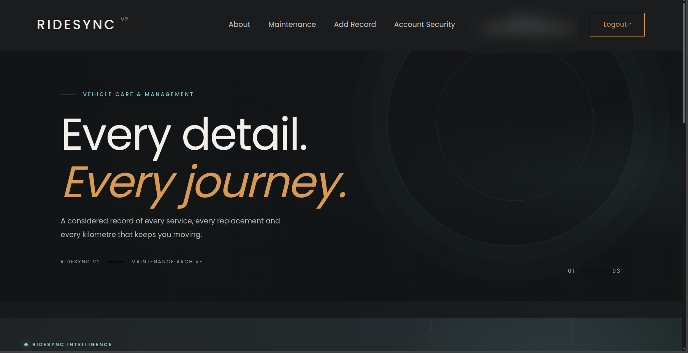
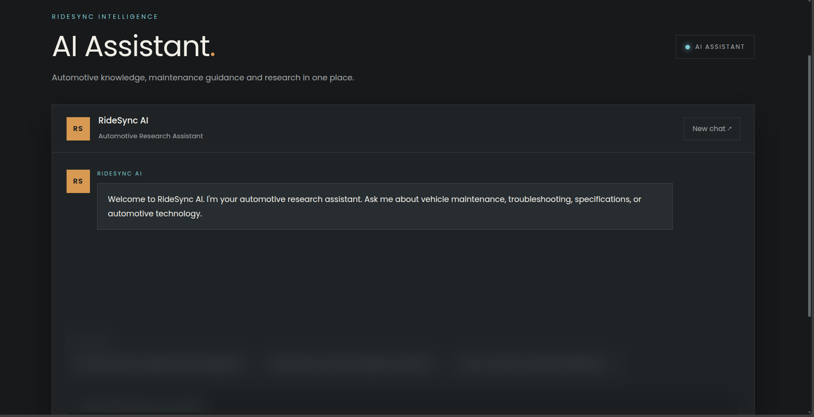
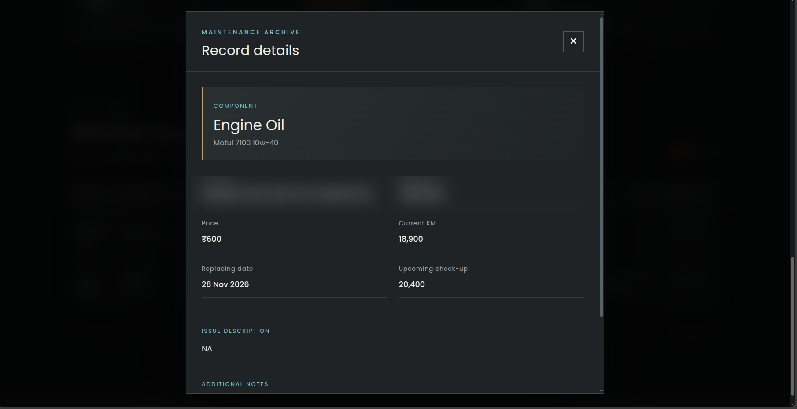
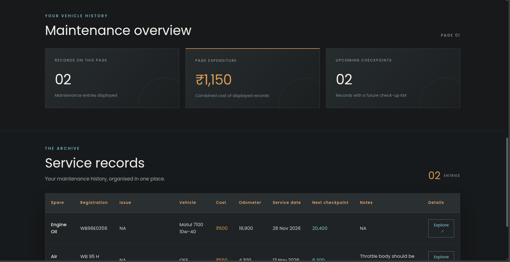
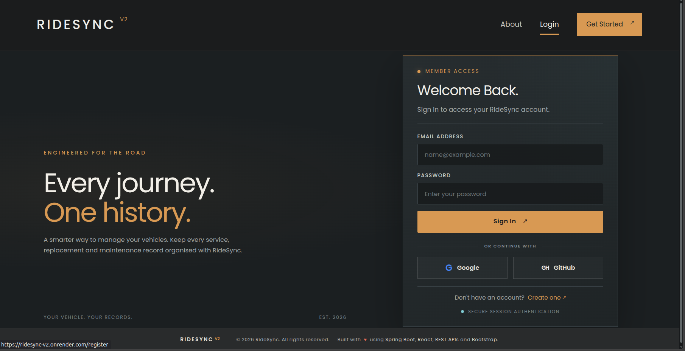

# RideSync v2

A full-stack vehicle care and maintenance management application for organizing service history, tracking maintenance expenditure, monitoring upcoming checkpoints, and accessing automotive guidance through an AI assistant.

**Live application:** https://ridesync-v2.onrender.com  
**Source code:** https://github.com/Rudra356/RideSync-v2

---

## Screenshots

### Landing page


### Maintenance overview


### Maintenance record details


### AI Assistant


### Authentication


---

## Features

- Manual account authentication and OAuth sign-in with Google and GitHub.
- Create and review vehicle service and replacement records.
- Maintenance overview with expenditure summaries and upcoming odometer checkpoints.
- Detailed maintenance entries with component, cost, service date, odometer reading, and notes.
- AI automotive assistant for maintenance, troubleshooting, specifications, and automotive topics.
- Dark, automotive-inspired user interface.

## Technology Stack

| Layer | Technologies |
|---|---|
| Frontend | React, Vite, JavaScript, Bootstrap, custom CSS |
| Backend | Java 21, Spring Boot, Spring MVC |
| Security | Spring Security, OAuth2, session authentication, CSRF protection |
| Data | Spring Data JPA, Hibernate, PostgreSQL |
| AI | Spring AI, Groq API |
| Build | Maven, npm |
| Deployment | Docker, Docker Hub, Render |

## Architecture

```text
React + Vite frontend
        │ HTTP / JSON
        ▼
Spring Boot application
(Controllers, Services, Security, OAuth2)
        │
        ├──────────────► PostgreSQL
        │
        └──────────────► Groq API
```

The frontend is built with Vite and packaged with the Spring Boot application. The application is containerized with Docker and deployed on Render.

## Running Locally

### Prerequisites

- Java 21
- Node.js 22 or later
- PostgreSQL
- Maven 3.9+
- npm

### 1. Clone the repository

```bash
git clone https://github.com/Rudra356/RideSync-v2.git
cd RideSync-v2
```

### 2. Configure environment variables

Create a `.env` file in the project root and provide the values required by your local environment:

```env
JDBC_DATABASE_URL=jdbc:postgresql://localhost:5432/ridesync
DB_USERNAME=your_database_username
DB_PASSWORD=your_database_password
GROQ_API_KEY=your_groq_api_key
```

Configure Google and GitHub OAuth client credentials if testing OAuth locally. Never commit `.env` files, API keys, OAuth secrets, or database passwords.

### 3. Install frontend dependencies

```bash
cd ridesync-frontend
npm install
cd ..
```

### 4. Run the backend

After configuring the required environment variables and database, run the Spring Boot application:

```bash
cd ridesync
mvn spring-boot:run
```

Check the project configuration for the expected local port and frontend development settings.

## Docker

The root-level Dockerfile builds the React frontend and Spring Boot backend into a deployable container image.

```bash
docker build -t ridesync-v2 .
docker run --env-file .env -p 8080:8080 ridesync-v2
```

For production, configure secrets and OAuth callback URLs through the hosting provider's environment settings. Do not bake secrets into the Docker image.

## Future Improvements

- Expand automated tests for authentication, maintenance workflows, and AI responses.
- Improve AI research source validation and response grounding.
- Add further vehicle and maintenance analytics.

## Author

**Rudra Naskar**  
BCA Graduate | Backend-focused Java Developer

- GitHub: https://github.com/Rudra356

## Disclaimer

RideSync is a personal software project. AI-generated automotive guidance is informational and should be checked against manufacturer documentation or a qualified mechanic before repairs or safety-critical work.
